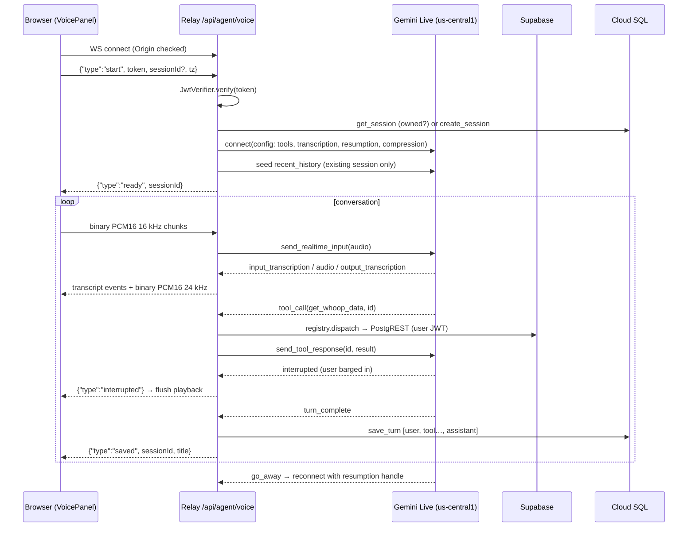

# Agent voice mode + Mumbai migration — design

Date: 2026-10-19 · Status: approved 2026-10-19 (user pre-approved after review)

## Intent

Let a signed-in user **talk** to the Agent and hear it talk back in real time, on the same Agent page, reusing the phase 1 chat stack (auth, tool registry, Cloud SQL sessions, sidebar). In the same project, move the backend from Europe to **Mumbai** so the compute, chat database and Supabase all sit next to the user, who is in India.

This is also a resume/interview project: choices should be clean and defensible, and existing code should keep its structure.

Success:
- On `dhimant.fun/habit` → Agent → Voice, the user asks "how did I sleep last night?" out loud, hears a correct answer within about a second of finishing, interrupts it mid-sentence by speaking (it stops at once), and later finds the conversation in the sidebar and reopens it as text.
- Text chat still works exactly as before, served from Mumbai.

## Goals

1. **Mumbai migration:** Cloud Run and Cloud SQL move to `asia-south1`. Text chat switches to a model served in Mumbai.
2. **Voice relay:** a WebSocket endpoint `/api/agent/voice` on the existing backend. It relays the browser to the **Gemini Live API** on Vertex AI.
3. **Tools in voice:** the Live model calls the same `get_whoop_data` tool through the existing `ToolRegistry`.
4. **Persistence:** transcripts (never audio) are saved as normal `user`/`tool`/`assistant` rows in the existing `messages` table under a normal session.
5. **Access control:** voice is **allowlist-only** with a server-side idle cutoff (user), because sign-up has no email confirmation and Live audio is billed per second.
6. **Desktop and mobile** (user), including iPhone Safari.
7. **Frontend:** a Text/Voice toggle, mic button, a visible state (idle / listening / thinking / speaking), a live transcript in the existing message list, and barge-in.

## Non-goals

Evals, RAG, extra tools, video input, voice selection UI, BigQuery sinks, per-user minute quotas (the allowlist + idle cutoff stand in for them), storing audio, a custom domain for the API.

## Anti-goals

- Any change to how text mode looks or behaves (apart from the backend URL and model).
- Keys or Google credentials in the browser. The relay authenticates to Vertex with the Cloud Run service account (ADC).
- One user reaching another's sessions or WHOOP data.
- Regressing the app's look or perf. CLAUDE.md perf rules apply: no animation behind `backdrop-filter`, no runtime CDN deps. Use only `transform`/`opacity` for the state indicator.
- Supabase schema/data/RLS changes. None are needed.
- The agent inventing numbers.

## Current state (explored 2026-10-19)

- **Backend** (`cloud-run-habit-tracker-backend`, private): FastAPI on Python 3.13, buildpacks via `Procfile` (no Dockerfile). Deployed by GitHub Actions on push to `main` (`.github/workflows/deploy.yml`) to Cloud Run `backend-service`, **europe-west1**, custom domain `api.dhimant.fun` (domain mapping).
  - Current Cloud Run settings: timeout 300s, concurrency 80, max 3 instances, 1 vCPU / 512Mi, SA `agent-runtime@…`.
  - Layout: `app/config.py` (frozen `Settings.from_env`), `app/auth.py` (`JwtVerifier`, Supabase ES256 via JWKS), `app/repo.py` (`ChatRepo`, every query scoped by user_id), `app/chat.py` (`ChatService`, SSE), `app/llm/gemini.py` (`GeminiService`), `app/llm/prompt.py` (`build_system_prompt`), `app/tools/` (`Tool` protocol, `ToolRegistry.dispatch` logs `tool_call`, `WhoopTool`), `app/log.py` (`log()` JSON lines + `RequestLogMiddleware`, which only handles `http` scopes), `app/__init__.py` (`create_app` with injectable pool/llm/registry).
- **Cloud SQL** `agent-pg`: Postgres 16, db-f1-micro (max ~25 connections), europe-west1. Tables `sessions`, `messages(role in user|assistant|tool)`, `schema_migrations`. ⚠️ `create_pool` uses asyncpg's default `max_size=10`, so 3 instances × 10 = 30 > 25.
- **Secrets** (automatic replication, so region-agnostic): `agent-db-password`, `supabase-url`, `supabase-publishable-key`.
- **Frontend** (`habit-tracker/src/app.jsx`): Agent is a header mode switch, not an `/agent` route. Relevant pieces:
  - `AGENT_API` constant; `agentFetch` attaches a fresh Supabase token on each call.
  - `AgentView` holds session state (`activeRef`, `useSession`, `loadTok`) and renders `ChatHistory`, `ChatThread` (user bubbles, assistant markdown, `ToolChip` from `m.tool`) and `Composer`.
  - `rowsToMessages` turns stored rows into UI messages.
  - `test-agent.js` mirrors pure helpers.
- **Supabase**: AWS `ap-south-1` (Mumbai).

## Model and region research (2026-10-19, measured from this project)

| Need | Choice | Why |
|---|---|---|
| Voice | **`gemini-3.8-live`** @ **`us-central1`** (user) | Newest GA native-audio Live model. Measured time to first audio from India ~610 ms, against ~1,050 ms for `gemini-live-2.5-flash-native-audio`. Same price ($3 / $12 per 1M audio tokens in/out ≈ $0.005 / $0.018 per min). **No Live model is served in any Asian region for this project** (probed asia-south1, asia-south2, asia-southeast1, asia-northeast1); 3.8-live exists only in us-central1. |
| Text | **`gemini-3.5-flash-lite`** @ **`asia-south1`** (user) | The only current model served in Mumbai. $0.30 / $2.50 per 1M tokens, against $0.75 / $3.75 for 3.8-flash, which doubles on 2027-01-01. First token was 1.6–2.1 s every run, against 10–206 s on `global` for 3.8-flash that day. Risk: one arithmetic slip in 4 runs. Watch for it in end-to-end testing; reverting is one env var. |

**Why the relay goes in Mumbai even though the voice model is in Iowa:** audio has to make the India↔us-central1 trip either way. Google's front end picks traffic up near the user (~15 ms measured) and carries it over its backbone, so a Mumbai relay adds no detour. Everything else the relay does (Supabase WHOOP reads, JWKS, Cloud SQL) becomes local; today those cross Europe↔India. If Google ships a Live model in India later, it's a one-env-var change.

Each model and location is **one setting** in `config.py`, overridable by env: `gemini_model` / `vertex_location` (text) and new `voice_model` / `voice_location` (voice).

## Target architecture

```
India browser ──HTTPS (SSE) / WSS──▶ Cloud Run backend-service (asia-south1, *.run.app URL)
                                       ├─ Cloud SQL agent-pg-in (asia-south1)        sessions/messages
                                       ├─ Supabase (Mumbai)                          JWKS + WHOOP via user JWT (RLS)
                                       ├─ Vertex gemini-3.5-flash-lite (asia-south1) text, unchanged code path
                                       └─ Vertex Live gemini-3.8-live (us-central1)  one upstream WSS per browser socket
```



## Decisions

Marked **(user)** where the user decided, **(call)** where it's my call for the builder to keep or revisit.

### Part A — Mumbai migration

- **Region `asia-south1` for Cloud Run and Cloud SQL (user).**
- **No custom domain (user).** Cloud Run domain mappings aren't offered in asia-south1, and the user declined the ~$18/mo load balancer. The frontend calls the deterministic URL `https://backend-service-211119777913.asia-south1.run.app`. Confirm it after the first deploy.
- **New Cloud SQL instance `agent-pg-in` (call).** Same tier (db-f1-micro), Postgres 16, same db `agent`, user `agent`, password from the existing `agent-db-password` secret. A new name is needed because `agent-pg` exists, and deleted instance names can't be reused for a while.
- **Data move (call):** run `scripts/migrate.py` against the new instance, then `gcloud sql export sql` from `agent-pg` to a temporary GCS bucket in asia-south1 and `gcloud sql import sql` into `agent-pg-in`. Grant each instance's service account access to the bucket, and delete the bucket afterwards. If export/import becomes fiddly, the data is a handful of chat rows, so copying the two tables with a small asyncpg script is acceptable. Chats written to the old instance between the export and the frontend switch are lost; this is a single-user window and accepted.
- **Deploy workflow:** `--region=asia-south1`, `--add-cloudsql-instances=…:asia-south1:agent-pg-in`, and env vars `VERTEX_LOCATION=asia-south1,GEMINI_MODEL=gemini-3.5-flash-lite,VOICE_MODEL=gemini-3.8-live,VOICE_LOCATION=us-central1,INSTANCE_CONNECTION_NAME=…:asia-south1:agent-pg-in`. Also update the matching `config.py` defaults.
- **Thinking level stays `low`** for 3.5-flash-lite (verified accepted).
- **Cloud Run settings (call):** `--timeout=3600` (a WebSocket is one request; 60 min is the max), `--concurrency=20` (relay work is I/O-bound at ~80 KB/s per conversation, and 20 keeps one instance from hoarding sockets), `--max-instances=3`, `--cpu-boost`, min instances 0. Text SSE shares these settings, which is harmless. Splitting voice into its own service is a later option if their scaling needs diverge.
- **DB pool cap:** `create_pool(..., max_size=5)` on both paths. 3 instances × 5 = 15, under db-f1-micro's ~25. This fixes a latent bug independent of voice.
- **Cutover order:**
  1. Create the new instance and migrate.
  2. Deploy to asia-south1.
  3. Smoke-test `/health` and a text chat with curl and a throwaway user.
  4. Switch the frontend `AGENT_API` and deploy it.
  5. Verify live.
  6. Then decommission: delete europe-west1 `backend-service`, its `api.dhimant.fun` domain mapping, the Hostinger DNS record for `api`, and Cloud SQL `agent-pg`. ⚠️ **Confirm with the user before deleting `agent-pg`**, since it can't be undone.
- **Docs:** update CLAUDE.md (Agent section: region, URL, models, instance name) and the memory pointer.

### Part B — Voice relay (backend)

**New module `app/voice.py`**, holding `voice_router` and `VoiceRelay`. Small edits elsewhere:
- `config.py`: `voice_model`, `voice_location`, `voice_allowed_emails: list[str]` (env `VOICE_ALLOWED_EMAILS`, comma-separated, default empty = nobody), `voice_idle_timeout_s: int = 180`.
- `__init__.py`: include `voice_router`; build `app.state.live` lazily as `genai.Client(vertexai=True, project, location=voice_location)`, injectable via `create_app(live=...)` like `llm`.
- `prompt.py`: a voice addendum.
- `repo.py`: title on first save, below.
- `db.py`: `max_size`.

**Wire protocol (browser ↔ relay):**
- Client → relay:
  - First frame, text JSON: `{"type":"start","token":"<supabase access_token>","sessionId":"<uuid>|null","tz":"Asia/Kolkata"}`. Token in the first message, **not the URL**, because Cloud Run request logs record full URLs (call). No start frame within 10 s → close.
  - Then **binary** frames: raw PCM16 LE mono 16 kHz, ~40 ms each (1,280 bytes).
  - Text `{"type":"auth","token":…}` at any time: re-verify and swap the token used for tool calls. Supabase tokens last 1 h, and a voice session can outlive one. The client sends it on supabase-js `TOKEN_REFRESHED`.
- Relay → client: text JSON events plus **binary** frames of PCM16 LE mono **24 kHz** model audio.
  - `ready {sessionId}`
  - `state {value: listening|thinking|speaking}`
  - `transcript {role: user|assistant, text}`, appended deltas
  - `tool {name, args}`
  - `interrupted`
  - `turn_done`
  - `saved {sessionId, title}`
  - `error {message}`
- **Close codes:** 4000 idle cutoff, 4401 bad/missing token, 4403 origin or user not allowed, 4404 session not found or not owned, 4408 no start frame, 1011 upstream failure, 1000 normal.

**Connect sequence:**
1. `accept()`. Check the `Origin` header against `settings.allowed_origins`; CORS middleware doesn't cover WebSockets.
2. Read the start frame and verify the token with `app.state.verifier`. **Allowlist (user):** the claims' `email` (Supabase puts it in the JWT), lowercased, must be in `settings.voice_allowed_emails`, or close **4403**. The same check applies to `auth` frames.
3. Session:
   - `sessionId` given → `repo.get_session`, or 4404.
   - Otherwise `repo.create_session(user, None)` and remember `new=True`.
4. Build `ToolContext(user_id, token, session_id, tz, settings, http)`. `tz` comes from the start frame, falling back to `settings.default_tz`, validated like `routes._tz`.
5. Open the Live session (config below).
   - Existing session: seed the last 20 user/assistant rows via `send_client_content(turns=[…], turn_complete=True)` with `history_config=HistoryConfig(initial_history_in_client_content=True)`. This is required on 3.8-live; see Open questions.
6. Send `ready`.

**`LiveConnectConfig` (call where not stated):**
- `response_modalities=["AUDIO"]`
- `system_instruction = build_system_prompt(now, voice=True)`. The new `voice` flag appends: you are speaking aloud; no markdown or lists; short spoken sentences; say durations as words like "seven hours twelve minutes"; "Format durations as Xh Ym" applies to text only.
- `tools=[Tool(function_declarations=[FunctionDeclaration(name, description, parameters_json_schema)])]`, built from `registry.specs()` the same way `GeminiService` builds them. Factor out a tiny shared helper only if the duplication bothers you (call).
- `input_audio_transcription=AudioTranscriptionConfig(custom_vocabulary=["WHOOP","strain","LeetCode"])` (call; drop the vocabulary if the field shape fights you) and `output_audio_transcription=AudioTranscriptionConfig()`.
- `session_resumption=SessionResumptionConfig(handle=<last handle or None>)`.
- `context_window_compression=ContextWindowCompressionConfig(trigger_tokens=32000, sliding_window=SlidingWindow(target_tokens=16000))` (call). This lifts the 15-min audio cap and bounds per-turn context cost.
- Default voice, automatic VAD and barge-in (no `realtime_input_config` overrides).

**Pumps:** two tasks under `asyncio.TaskGroup`. When either ends, the other is cancelled and both sockets close.
- *Browser → Live:*
  - Binary frame → `send_realtime_input(audio=Blob(data, mime_type="audio/pcm;rate=16000"))`.
  - `auth` frame → swap `ctx.access_token` after verifying it.
  - Browser close → end.
  - Mic frames that arrive while the upstream is reconnecting are dropped.
- *Live → browser:* loop `async for msg in session.receive()`. ⚠️ In google-genai, `receive()` ends after each `turn_complete`, so wrap it in `while True`. Handle each message:
  - `server_content.model_turn` inline audio → binary to browser. On the first chunk of a turn: `state speaking` and log first-audio latency.
  - `input_transcription.text` → append to the turn's user text; send `transcript user`.
  - `output_transcription.text` → append to the assistant text; send `transcript assistant`.
  - `tool_call.function_calls` → for each call: `state thinking`, send `tool` to the client, `result = await registry.dispatch(ctx, fc.name, args)`, record a tool row `{"name","args","result"}` (same JSON shape as text mode), then `send_tool_response(function_responses=[FunctionResponse(id=fc.id, name=fc.name, response=result)])`. **Always pass `id`** (3.8 requirement). Run calls sequentially; there's only one tool.
  - `tool_call_cancellation` → the result is discarded if still pending. Drop that call's tool row.
  - `server_content.interrupted` → send `interrupted`, then persist the turn so far (below).
  - `server_content.turn_complete` → persist the turn; send `turn_done` and `state listening`.
  - `session_resumption_update` with `resumable` and `new_handle` → keep the handle.
  - `go_away` → reconnect (below).
  - User finished speaking → `state thinking`. Use the server's voice-activity end signal if 3.8-live emits one (`voice_activity` / `voice_activity_detection_signal`; verify in step 2). Otherwise mark thinking when input transcription goes quiet before audio starts (call).

**Persistence (turn = what's buffered since the last save):**
- Rows in order: `("user", user_text)` if non-empty, the tool rows, `("assistant", assistant_text)` if non-empty. Saved via `repo.save_turn` in one transaction. Skip the save if no user or assistant text.
- An interrupted turn saves the partial assistant transcript as is (call).
- **Title:** `save_turn(..., title=None)` gains an optional title: `update sessions set updated_at = now(), title = coalesce(title, $3)`. The relay passes the first user transcript's first 60 chars. Text mode passes nothing, so its behaviour is unchanged. Then send `saved {sessionId, title}` so the sidebar can show the new session.
- **On disconnect:** save any unsaved turn that has user or assistant text. If the session was created by this connection and nothing was ever saved, delete it (same `_discard` pattern as `ChatService`). Empty sessions are already hidden by `list_sessions`, so this is cleanup, not correctness.

**Idle cutoff (user):** if no user speech (no `input_transcription`) arrives and the model isn't speaking or running a tool for `voice_idle_timeout_s` (180 s, call), send `error {message, code:"idle"}` and close **4000**. This prevents a forgotten open mic billing for up to an hour. Log it as `voice_disconnect reason=idle`.

**Access endpoint:** `GET /api/agent/config` (normal bearer auth) → `{"voice": <bool>}`, so the frontend can hide the toggle for users not on the allowlist. It's cheap and returns no other user data.

**Upstream drops and resumption:**
- On `go_away` or an unexpected upstream close (not caused by the browser leaving), reconnect with the saved handle. No re-seed; the server holds the context. Up to 3 attempts, 0.5 s / 1 s / 2 s backoff. Log `voice_resume`.
- No handle, or retries exhausted → send `error`, close with 1011.
- **Browser drops aren't resumed in the relay.** Handles live in process memory, and a reconnecting browser may land on another instance. The client starts a fresh voice connection with the same `sessionId`, and the relay re-seeds from Cloud SQL. The DB is the source of truth and the relay stays stateless across browser sockets (call).

**Logging** (same `log()`; never transcript text or tokens):
- `voice_connect {session_id, user_id, new}`
- `voice_disconnect {session_id, user_id, duration_s, turns, reason}`
- `voice_turn {session_id, first_audio_ms, tool_calls, interrupted}`. `first_audio_ms` runs from end of user speech (or the last input transcription) to the first audio chunk.
- `voice_resume {session_id, attempt, ok}`
- `voice_error {session_id, error}` (exception type only)
- `tool_call` is already logged by `ToolRegistry.dispatch` with name and latency.

**Test client (`scripts/voice_client.py`):**
- Inputs: a token (mint a throwaway `@example.com` user via the Supabase signup endpoint, as in phase 1) and the relay URL (local or run.app).
- Audio: a WAV/raw clip. Generate one with macOS `say -o q.aiff "How did I sleep last night?"` then `afconvert -f WAVE -d LEI16@16000 -c 1 q.aiff q.wav`. Don't commit audio.
- Streams the clip in 40 ms chunks plus ~1 s of silence so VAD ends the turn, then prints transcripts/events and saves the returned audio to `out.wav` for listening.

### Part C — Frontend (`src/app.jsx` only)

- **`AGENT_API`** → the asia-south1 run.app URL.
- **Visibility:** `AgentView` fetches `/api/agent/config` once. The Text|Voice toggle renders only when `voice` is true, so users not on the allowlist see text mode exactly as today.
- **Text | Voice toggle (call):** a compact segmented pill styled like `ModeSwitch`, in the chat panel's top row, right side. Text is the default and isn't remembered.
  - Voice mode replaces `Composer` with a `VoiceBar`; `ChatThread` is shared.
  - Switching back to Text, picking another session, New chat, or leaving Agent mode stops voice.
  - Starting voice continues the open session if there is one, otherwise starts a new one.
- **`VoiceBar`:** a large round mic button (start/stop), a state label plus a small indicator (idle / connecting / listening / thinking / speaking), and an error line.
  - The indicator animates **opacity/transform only**, sits outside any `backdrop-filter` surface, and has no animation while idle.
  - Error copy: mic denied → "Microphone access is blocked — allow it in your browser's site settings"; others → "Voice disconnected — tap the mic to resume".
- **`useVoice` hook (call) owns the socket and audio:**
  - `start()`: request the mic **only now** with `getUserMedia({audio:{echoCancellation:true,noiseSuppression:true,autoGainControl:true,channelCount:1}})`. Open the WebSocket to `AGENT_API.replace('https','wss') + '/api/agent/voice'` and send `start` with a fresh `sb.auth.getSession()` token, the active sessionId, and `Intl…timeZone`. Subscribe to `sb.auth.onAuthStateChange` and send an `auth` frame on `TOKEN_REFRESHED`.
  - **Capture:** a mic `AudioContext` (native rate) → `AudioWorkletNode`. The worklet source is an inline string loaded via a Blob URL: no extra file, no CDN, so the build is unchanged. The worklet downsamples to 16 kHz (box-filter average then decimate, holding a fractional position across blocks), converts float→Int16 LE, and posts ~40 ms (640-sample) chunks. The main thread sends them as binary.
  - **Playback:** a separate playback `AudioContext` at the **native rate**. Don't request 24 kHz, since iOS Safari may not honour it. Each binary frame → Int16→Float32 → `ctx.createBuffer(1, n, 24000)`, an AudioBuffer at its own rate that the browser resamples on playback → `AudioBufferSourceNode` scheduled at `next = max(ctx.currentTime + 0.02, next)`. Keep live sources in a Set.
  - **Output route (call, default for all platforms):** sources → `MediaStreamAudioDestinationNode` → a hidden `<audio autoplay playsinline>` with `srcObject` set. This is the path browser echo cancellation references most reliably, so the agent doesn't hear itself on laptop or phone speakers.
  - **Mobile unlock:** create **and `resume()`** both AudioContexts and call `audio.play()` synchronously inside the mic tap handler, before any `await`, or iOS keeps them suspended or muted.
  - **Backgrounding:** on `visibilitychange` → hidden, stop voice, since iOS suspends the mic anyway. Show the idle-style message on return.
  - **Interruption:** on `interrupted`, stop every source, clear the Set and reset `next`.
  - `stop()`: close the socket (1000), stop mic tracks, close both contexts, unsubscribe from auth.
  - Pure helpers `floatToPcm16`, `pcm16ToFloat` and the resampler step live between `PURE-BEGIN/END` and are mirrored in `test-agent.js` (call).
- **Messages in `AgentView`:**
  - `transcript user`: append to the current user bubble, or create one if the last message isn't an in-progress user turn.
  - `transcript assistant`: same for the assistant message (`streaming:true`).
  - `tool` → set `m.tool` on the current assistant message, which shows the existing `ToolChip`.
  - `turn_done` / `interrupted` → mark the assistant message not streaming; an interrupted one gets the existing `status:'stopped'` styling.
  - `ready` → `useSession(sessionId)`.
  - `saved` → insert or bump the session in the sidebar list with its title. This mirrors the text `session` event, but only after the first saved turn, so there are no ghost sessions.
- **Reopen as text:** works already. Voice rows are ordinary rows, and `rowsToMessages` renders them.
- **Echo:** browser AEC (`echoCancellation:true`) plus the `<audio>` output route above. Test without headphones on laptop speakers and on a real iPhone.
- **Mobile layout:** `VoiceBar` takes `Composer`'s place in the same column, so it works in the narrow layout unchanged. The toggle sits in the chat panel's top row, which exists on mobile too. The mic button is ≥ 56 px for touch. Opening the history drawer doesn't stop voice; picking a session in it does.

## Phases (user: stop for confirmation after each)

1. **Mumbai migration + text model switch** (Part A, including the DB pool cap). Verify text chat end to end from the deployed site against the new URL. Decommission europe-west1 at the end of this phase, after confirming with the user before deleting `agent-pg`.
2. **Relay:** endpoint, origin and token auth, Live open/close, audio both ways, `scripts/voice_client.py` printing the transcript of a recorded clip. Deploy (it's additive).
3. **Tools** over Live via `ToolRegistry.dispatch`. The test client asks a WHOOP question.
4. **Persistence:** session creation, history seeding, `save_turn` + title, discard of empty new sessions, resumption/reconnect.
5. **Frontend:** toggle, mic capture, playback, interruption, state indicator, live transcript.
6. **End to end on the live site:** a WHOOP question by voice on `dhimant16@gmail.com` (authorized for real-account testing; answers checked with Supabase SQL), an interruption on laptop speakers, reopening the voice chat as text, a non-allowlisted throwaway user seeing no Voice toggle (and getting 4403 from a raw socket), the idle cutoff, and **a real iPhone run by the user** (headless browsers can't check audio unlock or echo). Clean up test chats and throwaway users.

**Tests (call, kept small):** `tests/test_voice.py` drives `VoiceRelay` against a **fake Live session** injected through `create_app(live=…)`. It covers:
- missing/bad token → 4401
- foreign origin → 4403
- user not on the allowlist → 4403
- idle cutoff → 4000
- foreign sessionId → 4404
- audio relayed both ways
- a tool call dispatched with `id` echoed back
- turn saved with a title
- an interrupted turn saved partial
- `go_away` → reconnect with the handle
- an empty new session deleted on disconnect

Plus a `RUN_LIVE=1` test that opens a real 3.8-live session and gets audio and a transcript back. `node test-agent.js` covers the PCM helpers. Existing tests must stay green (`.venv/bin/pytest -q`, local Postgres).

Standing rules: no Claude attribution in commits, deploy after each phase and verify live, throwaway `*@example.com` users cleaned up, never touch other real users' data, concise comments.

## Open questions for the builder (verify, don't guess)

- ✅ **3.8-live history seeding: verified 2026-10-19.** `send_client_content([user…, model…], turn_complete=True)` with `initial_history_in_client_content=True` produced no messages for 6 s, and the next question was answered from the seeded history. `custom_vocabulary=["WHOOP"]` (list of str) and the resumption/compression config above were accepted.
- The exact end-of-user-speech signal 3.8-live emits, for the `thinking` state.
- Whether 3.8-live sends `session_resumption_update` only while idle. If so, the handle can lag mid-turn, which is acceptable.

## Later

Load balancer + custom domain or multi-region; splitting voice into its own Cloud Run service; per-user voice minute limits; a voice picker; min-instances=1 to remove the ~9 s cold start on first connect; India-hosted Live model when available.
